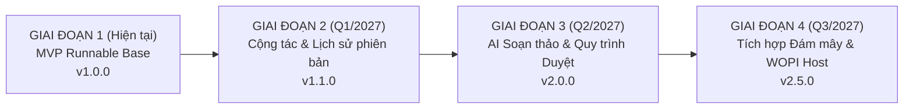

# LỘ TRÌNH PHÁT TRIỂN SẢN PHẨM (PRODUCT & TECHNICAL ROADMAP)
## SẢN PHẨM 1: THƯ VIỆN MẪU VĂN BẢN (DOCUMENT TEMPLATE LIBRARY)

Tài liệu này vạch ra tầm nhìn chiến lược, các mốc phát hành (Milestones) và kế hoạch nâng cấp phân hệ Thư viện mẫu văn bản từ phiên bản MVP hiện tại lên nền tảng cấp doanh nghiệp (Enterprise Grade).

---

## 1. TỔNG QUAN CÁC GIAI ĐOẠN PHÁT TRIỂN (PHASE OVERVIEW)

---

## 2. CHI TIẾT CÁC CỘT MỐC PHÁT HÀNH (RELEASE MILESTONES)

### Giai đoạn 1: Phiên bản Hiện tại (v1.0.0 - Production-Ready MVP)
*Mục tiêu*: Phát hành phiên bản MVP v1.0.0 hoàn chỉnh, độc lập và sẵn sàng vận hành thực tế.
- [x] Thư viện 5 biểu mẫu văn phòng chuẩn hóa (Hợp đồng, Đơn từ, Biên bản, Báo cáo, Đề xuất).
- [x] Bộ lọc theo 5 danh mục nghiệp vụ và tìm kiếm thời gian thực theo từ khóa/tags.
- [x] Modal xem trước trực quan mô phỏng chuẩn giấy in A4.
- [x] **Cơ chế Copy-on-Create**: Sao chép sâu độc lập tài liệu người dùng, bảo vệ tuyệt đối tính bất biến của mẫu gốc (Immutability).
- [x] Trình soạn thảo Rich Text Editor trực quan với đầy đủ thanh công cụ Toolbar (H1/H2/H3, Bold, Italic, Table, Căn lề).
- [x] Chức năng Lưu tài liệu và Xuất file Microsoft Word (`.docx`) giữ nguyên cấu trúc văn bản.
- [x] Xử lý trạng thái tải Skeleton Shimmer, Empty State và Toast phản hồi.
- [x] Bộ kiểm thử tự động (Automated Test Suite) đạt tỷ lệ đạt 100%.

---

### Giai đoạn 2: Nâng cấp Trải nghiệm & Phiên bản hóa (v1.1.0 - Collaboration & Versioning)
*Thời gian dự kiến*: Quý 1 / 2027  
*Mục tiêu*: Hỗ trợ nhóm làm việc cộng tác và quản lý lịch sử chỉnh sửa.
- [ ] **Lịch sử Phiên bản (Document Version History)**:
  - Cho phép người dùng lưu các mốc "Snapshot" tài liệu (v1.0, v1.1, v1.2...).
  - So sánh khác biệt trực quan (Visual Diffing) giữa hai phiên bản tài liệu.
  - Phục hồi lại nội dung ở bất kỳ phiên bản nào trong quá khứ.
- [ ] **Tự động lưu với Debounce (Debounced Auto-save)**:
  - Lưu ngầm nội dung sau 1.5 giây khi người dùng ngừng gõ phím.
  - Hiển thị timestamp chính xác: *"Đã lưu ngầm lúc 14:32:05"*.
- [ ] **Hệ thống Quản lý Biểu mẫu Động (Dynamic Template CMS)**:
  - Giao diện Admin cho phép tải lên file mẫu DOCX từ máy tính.
  - Tự động bóc tách (parse) file DOCX thành template HTML có sẵn trong hệ thống.

---

### Giai đoạn 3: Trợ lý AI & Quy trình Phê duyệt (v2.0.0 - AI Smart Office & Workflows)
*Thời gian dự kiến*: Quý 2 / 2027  
*Mục tiêu*: Tối ưu hóa năng suất doanh nghiệp bằng trí tuệ nhân tạo.
- [ ] **Trợ lý AI Điền Mẫu Tự Động (AI Autofill Assistant)**:
  - Đọc hồ sơ nhân viên / đối tác và tự động điền các trường placeholder trong hợp đồng (Tên, Số CCCD, Địa chỉ, Tiền lương).
  - Tóm tắt nội dung văn bản dài hoặc kiểm tra ngữ pháp tiếng Việt tự động.
- [ ] **Quy trình Trình ký & Phê duyệt (Approval Workflow)**:
  - Luồng trạng thái: `Dự thảo (Draft)` $\rightarrow$ `Chờ duyệt (Pending)` $\rightarrow$ `Đã duyệt (Approved)` $\rightarrow$ `Ký số (Signed)`.
  - Phân quyền theo vai trò: Nhân viên soạn thảo, Trưởng phòng ký nháy, Giám đốc ký duyệt.

---

### Giai đoạn 4: Mở rộng Đám mây & Chuẩn Doanh Nghiệp (v2.5.0 - Enterprise Cloud)
*Thời gian dự kiến*: Quý 3 / 2027  
*Mục tiêu*: Tích hợp hệ sinh thái lưu trữ đám mây của doanh nghiệp.
- [ ] Tích hợp đồng bộ Google Drive, OneDrive và Nextcloud.
- [ ] Triển khai kết nối cơ sở dữ liệu PostgreSQL kèm Prisma ORM cho môi trường High Availability (HA).
- [ ] Xác thực doanh nghiệp qua Single Sign-On (SSO): Google Workspace SAML, Microsoft Entra ID.

---

## 3. MA TRẬN QUẢN TRỊ RỦI RO KỸ THUẬT (TECHNICAL RISK MATRIX)

| Rủi ro kỹ thuật | Mức độ | Khả năng xảy ra | Giải pháp ứng phó đã chuẩn bị |
| :--- | :---: | :---: | :--- |
| **Xung đột ghi đè mẫu gốc (Template Mutation)** | **Nghiêm trọng** | Thấp | Đã áp dụng cơ chế **Physical Isolation** và **Deep Copy** tại `DocumentService`. Kiểm tra tự động bằng unit test trong CI/CD. |
| **Lệch style khi xuất file DOCX trên Word cũ** | Trung bình | Trung bình | Sử dụng thư viện `docx` tạo tệp OpenXML chuẩn quốc tế theo tiêu chuẩn ISO/IEC 29500, đảm bảo tính tương thích từ Word 2013 đến Microsoft 365. |
| **Mất dữ liệu khi người dùng thoát đột ngột** | Trung bình | Trung bình | Đã thiết kế state `hasUnsavedChanges` cảnh báo trước khi rời trang và lộ trình bổ sung Auto-save ngầm. |

---

## 4. CHIẾN LƯỢC KIẾN TRÚC BACKEND & KẾ HOẠCH BÓC TÁCH (BACKEND DECOUPLING ROADMAP)
- **Thiết kế hiện tại (All-in-one Monorepo)**: Tận dụng trực tiếp Next.js Route Handlers (`src/app/api/`) và Domain Services (`src/server/services/`) để hệ thống tự vận hành (Zero-Configuration), giúp việc khởi chạy và kiểm thử tự động đạt tốc độ tức thì mà không cần cài đặt Database hay service phụ trợ.
- **Kế hoạch bóc tách khi mở rộng (Phase 3-4)**: Tầng nghiệp vụ `src/server/services/` sẵn sàng chuyển đổi thành Dedicated Standalone Backend Microservice (NestJS / Go). Tầng Client đã trừu tượng hóa qua `DocumentApiService` kế thừa `BaseApiService` từ package `core`, do đó chỉ cần cấu hình lại `NEXT_PUBLIC_BASE_API` là kết nối ngay mà hoàn toàn không cần refactor giao diện người dùng.

