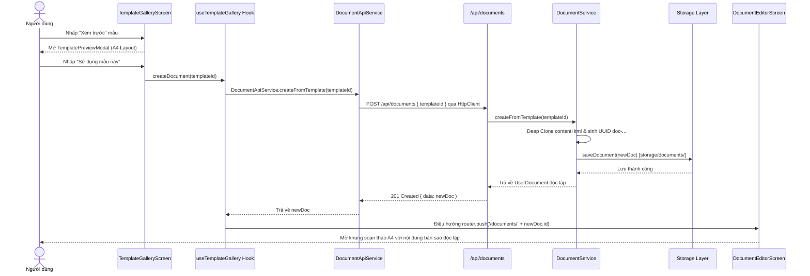
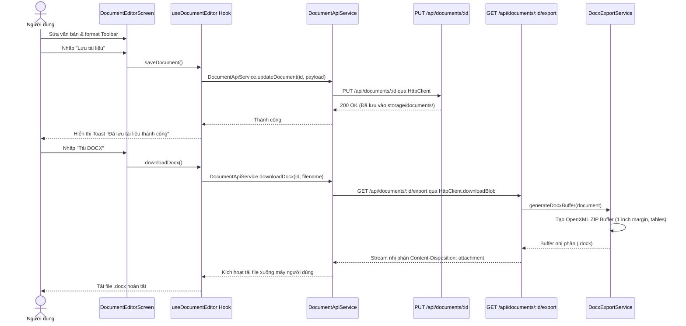
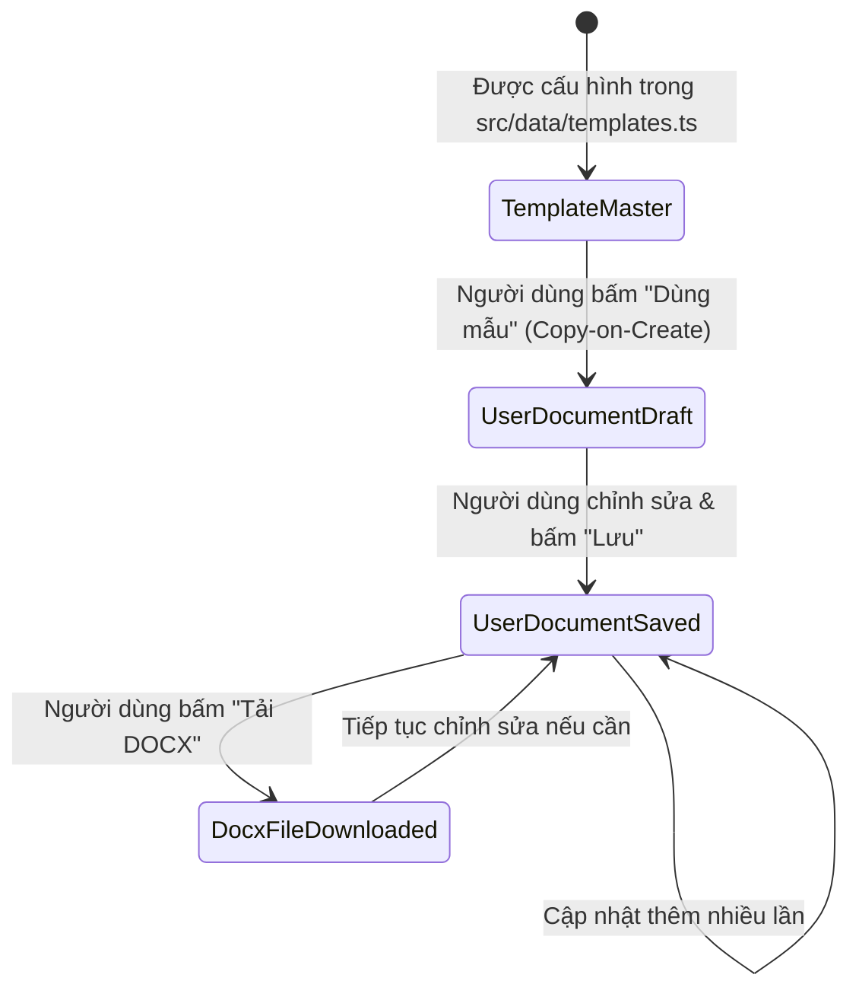

# CẤU TRÚC MÃ NGUỒN & KIẾN TRÚC PHẦN MỀM (STRUCTURE DOCUMENT)
## SẢN PHẨM 1: THƯ VIỆN MẪU VĂN BẢN (DOCUMENT TEMPLATE LIBRARY)

Tài liệu này giải thích chi tiết cấu trúc thư mục, trách nhiệm của từng thành phần mã nguồn và luồng luân chuyển dữ liệu bên trong **Sản phẩm 1** theo mô hình **Feature-Driven Architecture** và **Pure Data Access Layer**.

---

## 1. SƠ ĐỒ CÂY THƯ MỤC CHI TIẾT (PROJECT TREE)

```
project-1-doc-template/
├── docs/                                  # TÀI LIỆU KỸ THUẬT & QUẢN TRỊ
│   ├── SRS.md                             # Đặc tả yêu cầu phần mềm chi tiết
│   ├── ARCHITECTURE.md                    # Kiến trúc phân lớp & cơ chế Immutability
│   ├── API_SPEC.md                        # Đặc tả toàn bộ API Routes & Contracts
│   ├── PLAN.md                            # Kế hoạch triển khai & danh mục việc cần làm
│   ├── ROADMAP.md                         # Lộ trình phát triển sản phẩm theo các giai đoạn
│   └── STRUCTURE.md                       # Tài liệu cấu trúc mã nguồn này
│
├── public/                                # TÀI NGUYÊN TĨNH (STATIC ASSETS)
│   └── thumbnails/                        # Ảnh thumbnail biểu mẫu vector SVG
│       ├── employment-contract.svg        # Thumbnail Mẫu Hợp đồng lao động
│       ├── leave-request.svg              # Thumbnail Mẫu Đơn xin nghỉ phép
│       ├── meeting-minutes.svg            # Thumbnail Mẫu Biên bản cuộc họp
│       ├── project-report.svg             # Thumbnail Mẫu Báo cáo tiến độ
│       └── project-proposal.svg           # Thumbnail Mẫu Bản đề xuất dự án
│
├── src/                                   # MÃ NGUỒN CHÍNH (TYPESCRIPT)
│   ├── app/                               # [App Router] Vỏ định tuyến mỏng (Thin Routing Shell)
│   │   ├── api/                           # TẦNG CONTROLLER / API ROUTES
│   │   │   ├── documents/
│   │   │   │   ├── route.ts               # POST: Tạo mới doc; GET: Danh sách doc
│   │   │   │   └── [id]/
│   │   │   │       ├── route.ts           # GET: Lấy doc; PUT: Cập nhật doc
│   │   │   │       └── export/
│   │   │   │           └── route.ts       # GET: Xuất file DOCX nhị phân
│   │   │   └── templates/
│   │   │       ├── route.ts               # GET: Danh sách mẫu & lọc danh mục
│   │   │       └── [id]/
│   │   │           └── route.ts           # GET: Chi tiết mẫu để preview
│   │   ├── documents/
│   │   │   └── [id]/
│   │   │       └── page.tsx               # Thin shell router -> render DocumentEditorScreen
│   │   ├── layout.tsx                     # Layout dùng chung toàn ứng dụng
│   │   ├── not-found.tsx                  # Trang 404 thân thiện khi sai mã ID
│   │   └── page.tsx                       # Thin shell router -> render TemplateGalleryScreen
│   │
│   ├── features/                          # [Feature-Driven Modules] Phân hệ nghiệp vụ độc lập
│   │   ├── editor/                        # Phân hệ trình soạn thảo văn bản
│   │   │   ├── components/
│   │   │   │   └── editor-toolbar.tsx     # Thanh công cụ định dạng Rich Text & Bảng
│   │   │   ├── hooks/
│   │   │   │   └── use-document-editor.ts # Hook quản lý nội dung, auto-save, export DOCX
│   │   │   └── screens/
│   │   │       └── document-editor-screen.tsx # Màn hình soạn thảo trang giấy A4 hoàn chỉnh
│   │   │
│   │   └── templates/                     # Phân hệ thư viện & duyệt biểu mẫu
│   │       ├── components/
│   │       │   ├── category-filter.tsx    # Thanh lọc danh mục với badge số lượng
│   │       │   ├── template-card.tsx      # Thẻ card biểu mẫu hiển thị thumbnail
│   │       │   └── template-preview-modal.tsx # Modal xem trước định dạng chuẩn A4
│   │       ├── hooks/
│   │       │   └── use-template-gallery.ts# Hook xử lý search debounce, category filter
│   │       └── screens/
│   │           └── template-gallery-screen.tsx # Màn hình thư viện hiển thị lưới biểu mẫu
│   │
│   ├── services/                          # [Pure Data Access Layer] Tầng giao tiếp API thuần
│   │   ├── core/
│   │   │   ├── base-api.service.ts        # BaseApiService: Axios Interceptor, Bearer Token, Offline Guard, Path Params
│   │   │   ├── types.ts                   # RequestConfig, BaseResponse<T>, ApiError, HttpMethod
│   │   │   └── http-client.ts             # Re-export BaseApiService & types
│   │   ├── documents/
│   │   │   └── document-api.service.ts    # DocumentApiService extends BaseApiService (_get, _post, _put, downloadBlob)
│   │   └── templates/
│   │       └── template-api.service.ts    # TemplateApiService extends BaseApiService (_get with pathParams)
│   │
│   ├── shared/                            # [Shared Foundation & Design System]
│   │   ├── components/
│   │   │   └── ui/                        # Bộ Shadcn/UI chuẩn hóa (kebab-case)
│   │   │       ├── badge.tsx              # Huy hiệu phân loại & trạng thái
│   │   │       ├── button.tsx             # Button chuẩn design system (variant & size)
│   │   │       ├── card.tsx               # Khung Card bao bọc nội dung
│   │   │       ├── dialog.tsx             # Dialog mở rộng chuẩn Radix UI
│   │   │       ├── input.tsx              # Input field hỗ trợ search icon
│   │   │       ├── modal.tsx              # Modal popup đa kích thước
│   │   │       ├── separator.tsx          # Đường ngăn cách phân vùng
│   │   │       ├── skeleton.tsx           # Khung xương loading shimmer
│   │   │       ├── tabs.tsx               # Bộ tab chuyển đổi
│   │   │       └── tooltip.tsx            # Tooltip giải thích thao tác
│   │   └── utils/
│   │       └── utils.ts                   # Hàm tiện ích cn(), format ngày tháng
│   │
│   ├── server/                            # TẦNG DỊCH VỤ BACKEND (DOMAIN SERVICES)
│   │   └── services/
│   │       ├── document.service.ts        # Quản lý nhân bản và lưu trữ UserDocument
│   │       ├── docx-export.service.ts     # Phân tích cú pháp & sinh file Word OpenXML
│   │       ├── storage.service.ts         # Giao tiếp I/O vật lý tới thư mục storage/
│   │       └── template.service.ts        # Truy vấn, tìm kiếm, lọc biểu mẫu gốc
│   │
│   ├── data/                              # DỮ LIỆU BAN ĐẦU (SEED DATA)
│   │   └── templates.ts                   # 5 bộ dữ liệu biểu mẫu mẫu chuẩn mực
│   │
│   └── types/                             # ĐỊNH NGHĨA KIỂU DỮ LIỆU & ENUMS
│       └── index.ts                       # TemplateCategory, DocumentStatus, Template, UserDocument
│
├── storage/                               # VÙNG LƯU TRỮ VẬT LÝ (FILE REPOSITORY)
│   ├── documents/                         # Thư mục lưu tài liệu do người dùng tạo (*.json)
│   └── templates/                         # Thư mục chứa tài nguyên mẫu gốc (Read-only)
│
├── tests/                                 # BỘ KIỂM THỬ TỰ ĐỘNG (AUTOMATED TEST SUITE)
│   └── verify-all.ts                      # Kiểm thử Seed Data, Filter, Immutability & DOCX
│
├── components.json                        # Cấu hình chuẩn Shadcn/UI (New York style, slate base)
├── next.config.ts                         # Cấu hình Next.js
├── package.json                           # Khai báo dependencies & scripts
├── tsconfig.json                          # Cấu hình TypeScript compiler
└── README.md                              # Báo cáo tổng kết bàn giao Sản phẩm 1
```

---

## 2. TRÁCH NHIỆM TỪNG PHÂN TẦNG (LAYERED ARCHITECTURE RESPONSIBILITIES)

| Phân tầng | Vị trí thư mục | Trách nhiệm chính |
| :--- | :--- | :--- |
| **Shared Core Package** | `packages/core` (`@preview/core`, `@preview/core/server`) | • Gói thư viện dùng chung trong Monorepo pnpm workspace.<br>• `HttpClient`: Centralized HTTP Client xử lý query params, interceptor, Blob download.<br>• `BaseCatalogService`: Quản lý tìm kiếm, lọc danh mục, tính count & mở rộng runtime.<br>• `BaseStorageRepository`: Lớp cơ sở trừu tượng quản lý I/O tệp tin độc lập.<br>• `APP_ROUTES`, `API_ROUTES`: Hằng số URL routes tập trung chống hardcode.<br>• Tiện ích tái sử dụng: `buildUrlWithParams`, `createAttachmentHeaders`, `sanitizeFileName`, `formatFileSize`. |
| **Thin Routing Shell** | `src/app/` | • Chứa routing shells mỏng nhẹ theo Next.js App Router.<br>• Chuyển tiếp trách nhiệm trực tiếp cho `src/features/*/screens/`. |
| **Feature-Driven Modules** | `src/features/` | • Đóng gói độc lập theo nghiệp vụ (`templates/`, `editor/`).<br>• `screens/`: Ghép nối giao diện hoàn chỉnh.<br>• `components/`: Component con dùng riêng cho phân hệ (kebab-case).<br>• `hooks/`: Custom hooks đóng gói state và kết nối service layer. |
| **Pure Data Access Layer (BaseApiService)** | `src/services/core/base-api.service.ts`, `src/services/*/` | • Lớp trừu tượng `BaseApiService` bọc `AxiosInstance` chuẩn hóa.<br>• Tự động gắn Bearer Token từ Zustand `useAuthStore`.<br>• Offline Guard ngăn request rác qua `useAppStore`.<br>• Format URL động `:id` và `{id}` qua `pathParams`.<br>• Tự động bóc tách mảng lỗi backend (`flattenApiErrors`) & kích hoạt Toast (`toast.error`).<br>• Các domain services kế thừa `BaseApiService` và gọi `this._get`, `this._post`, `this._put`, `this._delete`. |
| **Custom Portal System** | `src/store/layout.store.ts`, `src/shared/components/portal-renderer.tsx`, `src/shared/hooks/use-portal.ts` | • Quản lý Stacking Portals toàn cục bằng Zustand.<br>• Cho phép gọi modal qua Hook (`usePortal`) và Imperative Call từ tầng Services (`confirmModal.show`).<br>• Giải quyết triệt để vấn đề Z-Index & Stacking Context. |
| **Shared Design System** | `src/shared/components/ui/` | • Bộ thành phần UI Shadcn/UI chuẩn hóa (kebab-case).<br>• Tuân thủ nghiêm ngặt quy chuẩn Button Design System (chỉ dùng variant & size, không custom class ghi đè). |
| **API Controller Layer** | `src/app/api/` | • Tiếp nhận HTTP Request (GET, POST, PUT).<br>• Trích xuất query params (`category`, `search`), parse JSON body.<br>• Trả về định dạng chuẩn `ApiResponse<T>` với HTTP Status Code tương ứng (200, 201, 400, 404, 500). |
| **Domain Service Layer** | `src/server/services/` | • Thực thi logic nghiệp vụ cốt lõi phía server.<br>• `DocumentService`: Thực thi thuật toán Copy-on-Create, đảm bảo tách biệt bộ nhớ.<br>• `DocxExportService`: Phân tích HTML blocks $\rightarrow$ docx Paragraphs / Tables $\rightarrow$ OpenXML Buffer.<br>• `TemplateService`: Xử lý thuật toán tìm kiếm đa tiêu chí. |
| **Storage Repository Layer** | `src/server/services/storage.service.ts`, `storage/` | • Đọc / ghi file vật lý trên máy chủ cục bộ.<br>• Đảm bảo `storage/templates/` mang tính bất biến (Read-only) và `storage/documents/` mang tính Read-Write. |

---

## 3. SƠ ĐỒ LUỒNG DỮ LIỆU (SEQUENCE DIAGRAM)

### Luồng 1: Xem trước và Sử dụng Mẫu tạo Tài liệu mới


### Luồng 2: Chỉnh sửa và Xuất file Word (.docx)


---

## 4. CHIẾN LƯỢC QUẢN LÝ DỮ LIỆU & ENUMS CHUẨN HÓA

### Định nghĩa Enums (`src/types/index.ts`):
- `TemplateCategory`: `ALL = 'all'`, `CONTRACT = 'contract'`, `HR = 'hr'`, `MINUTES = 'minutes'`, `REPORT = 'report'`, `PROPOSAL = 'proposal'`.
- `DocumentStatus`: `DRAFT = 'draft'`, `SAVED = 'saved'`, `ARCHIVED = 'archived'`.
- `BadgeVariant`: `DEFAULT = 'default'`, `SECONDARY = 'secondary'`, `DESTRUCTIVE = 'destructive'`, `OUTLINE = 'outline'`.
- `ButtonVariant`: `DEFAULT = 'default'`, `SECONDARY = 'secondary'`, `OUTLINE = 'outline'`, `GHOST = 'ghost'`, `SUBTLE = 'subtle'`, `DESTRUCTIVE = 'destructive'`.
- `ButtonSize`: `DEFAULT = 'default'`, `SM = 'sm'`, `LG = 'lg'`, `ICON = 'icon'`.
- `ModalMaxWidth`: `SM = 'sm'`, `MD = 'md'`, `LG = 'lg'`, `XL = 'xl'`, `TWO_XL = '2xl'`, `FOUR_XL = '4xl'`, `FULL = 'full'`.

### Vòng đời của một tài liệu:

* **Tính độc lập tuyệt đối**: Khi tài liệu chuyển sang trạng thái `UserDocument`, mọi thao tác cập nhật tiêu đề, xóa đoạn văn, chèn bảng biểu hoàn toàn bị cô lập trong tệp `storage/documents/{docId}.json`. File gốc trong `storage/templates/` không bị tác động.
