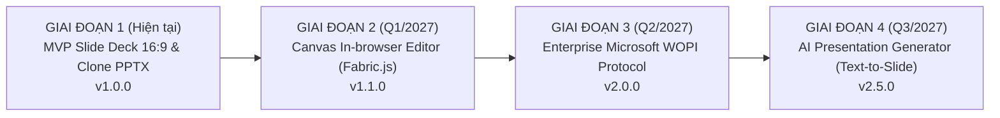
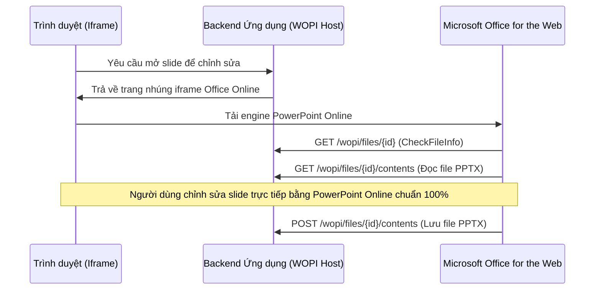

# LỘ TRÌNH PHÁT TRIỂN SẢN PHẨM (PRODUCT & TECHNICAL ROADMAP)
## SẢN PHẨM 2: THƯ VIỆN MẪU TRÌNH CHIẾU (PRESENTATION TEMPLATE LIBRARY)

Tài liệu này vạch ra tầm nhìn kỹ thuật, các mốc phát hành (Milestones) và kế hoạch nâng cấp phân hệ Thư viện mẫu trình chiếu PowerPoint, đặc biệt là **kế hoạch tích hợp trình chỉnh sửa slide trực tuyến (In-browser Slide Editor)**.

---

## 1. TỔNG QUAN CÁC GIAI ĐOẠN PHÁT TRIỂN (PHASE OVERVIEW)



---

## 2. CHI TIẾT CÁC CỘT MỐC PHÁT HÀNH (RELEASE MILESTONES)

### Giai đoạn 1: Phiên bản Hiện tại (v1.0.0 - Production-Ready MVP)
*Mục tiêu*: Phát hành phiên bản MVP v1.0.0 hoàn chỉnh, độc lập và sẵn sàng vận hành thực tế.
- [x] Thư viện 3 bộ template PowerPoint chuẩn mực (Pitch Deck gọi vốn, Báo cáo quý, Kế hoạch ra mắt sản phẩm) gồm 15 trang slide 16:9 sắc nét.
- [x] Tìm kiếm thời gian thực và phân loại bộ slide theo chuyên ngành.
- [x] **Trình duyệt Slide Deck Cinema 16:9**:
  - Màn hình chiếu slide lớn có điều hướng trước/sau và bộ đếm trang (`Slide X / 5`).
  - Thanh cuộn **Filmstrip Carousel** xem lướt và nhấp chọn chuyển đổi nhanh giữa các slide con trong bộ mẫu.
- [x] **Cơ chế Copy-on-Create**: Tự động nhân bản độc lập file `.pptx` từ kho mẫu sang file của người dùng, bảo vệ nguyên vẹn 100% file gốc.
- [x] Tải xuống file PowerPoint (`.pptx`) nhị phân chuẩn OpenXML với đầy đủ text, màu sắc và layout.
- [x] Báo cáo kỹ thuật phân tích giới hạn của PPTX trên web và định hướng tích hợp Editor.
- [x] Bộ kiểm thử tự động (Automated Test Suite) đạt tỷ lệ đạt 100%.

---

### Giai đoạn 2: Tích hợp Trình Biên Tập Slide Canvas Trực Tuyến (v1.1.0 - In-browser Slide Editor)
*Thời gian dự kiến*: Quý 1 / 2027  
*Mục tiêu*: Cho phép người dùng chỉnh sửa chữ, màu sắc và hình ảnh trực tiếp trên trình duyệt mà không cần cài đặt phần mềm ngoài.

#### Giải pháp Kỹ thuật: HTML5 Canvas Engine (Fabric.js / Konva.js)
```
┌────────────────────────────────────────────────────────┐
│             CANVAS SLIDE EDITOR ARCHITECTURE           │
│                                                        │
│  [Slide Selector]   [Canvas Viewport (16:9)] [Toolbar] │
│   - Slide 1          - Editable Text Objects  - Font    │
│   - Slide 2          - Vector Shapes/Icons    - Color   │
│   - Slide 3          - Image Upload / Drag    - Align   │
│                                                        │
│  State: JSON Schema (Canvas State)                     │
│  Export Engine: pptxgenjs (Canvas JSON -> Native PPTX) │
└────────────────────────────────────────────────────────┘
```
- [ ] Xây dựng khung soạn thảo Canvas tỷ lệ 16:9 bằng thư viện **Fabric.js**.
- [ ] Chuyển đổi các slide trong bộ mẫu thành các đối tượng JSON (Text box, Rectangle, Image).
- [ ] Cho phép người dùng:
  - Nhấp đúp vào chữ trên slide để chỉnh sửa nội dung.
  - Kéo thả (drag-and-drop) thay đổi vị trí, kích thước đối tượng.
  - Thay đổi màu nền, font chữ và chèn thêm ảnh từ máy tính.
- [ ] Khi bấm "Lưu & Tải về": Sử dụng engine `pptxgenjs` để ánh xạ các đối tượng Canvas thành các slide PowerPoint nguyên bản.

---

### Giai đoạn 3: Tích hợp Microsoft Office Online Doanh Nghiệp (v2.0.0 - WOPI Integration)
*Thời gian dự kiến*: Quý 2 / 2027  
*Mục tiêu*: Đạt độ tương thích 100% với định dạng của Microsoft bằng kiến trúc Enterprise Standard.

#### Giải pháp Kỹ thuật: Giao thức WOPI (Web Application Open Platform Interface)

- [ ] Xây dựng các WOPI Host Endpoints: `CheckFileInfo`, `GetFile`, `PutFile`, `Lock`, `Unlock`.
- [ ] Nhúng trực tiếp iframe PowerPoint Online của Microsoft Office 365.
- [ ] Giữ nguyên 100% vector shapes phức tạp, SmartArt và hiệu ứng Animation chuyển trang.

---

### Giai đoạn 4: Trợ lý AI Sinh Slide Thông Minh (v2.5.0 - AI Text-to-Slide)
*Thời gian dự kiến*: Quý 3 / 2027  
*Mục tiêu*: Tạo bài thuyết trình hoàn chỉnh từ văn bản thô bằng AI.
- [ ] Nhập văn bản đề cương hoặc tài liệu Word $\rightarrow$ AI tự động bóc tách thành dàn ý bài thuyết trình (5-10 slide).
- [ ] Tự động gán layout phù hợp (Cover, Vấn đề, Giải pháp, Biểu đồ KPI, Kết luận).
- [ ] Sinh ảnh minh họa phù hợp với nhận diện thương hiệu của bài thuyết trình.

---

## 3. MA TRẬN QUẢN TRỊ RỦI RO KỸ THUẬT (TECHNICAL RISK MATRIX)

| Rủi ro kỹ thuật | Mức độ | Khả năng xảy ra | Giải pháp ứng phó đã chuẩn bị |
| :--- | :---: | :---: | :--- |
| **Xung đột sửa đổi file mẫu PPTX gốc** | **Nghiêm trọng** | Thấp | Đã áp dụng cơ chế **File Stream Copy** sang `storage/presentations/`. File gốc mang thuộc tính Read-only, được kiểm chứng qua `tests/verify-all.ts`. |
| **Lệch font chữ khi mở PPTX trên máy tính khác** | Trung bình | Trung bình | Cấu hình sử dụng các font chữ chuẩn hệ thống quốc tế (Calibri, Arial, Helvetica) được hỗ trợ đồng bộ trên Windows, macOS và Linux. |
| **Độ trễ khi chuyển đổi slide nhiều ảnh** | Thấp | Thấp | Đã tối ưu hóa sử dụng ảnh vector SVG nhẹ (~15KB/slide), load tức thì không tiêu tốn băng thông. |

---

## 4. CHIẾN LƯỢC KIẾN TRÚC BACKEND & KẾ HOẠCH BÓC TÁCH (BACKEND DECOUPLING ROADMAP)
- **Thiết kế hiện tại (All-in-one Monorepo)**: Backend hiện được tích hợp trực tiếp qua Next.js Route Handlers (`src/app/api/`) và Domain Services (`src/server/services/`). Thiết kế này tối ưu hóa khả năng tự cấp tự túc của Monorepo, giúp khởi chạy tức thì và kiểm thử tự động đạt độ tin cậy 100% mà không đòi hỏi bất kỳ Database hay service phụ trợ nào.
- **Kế hoạch bóc tách khi mở rộng (Phase 3-4)**: Toàn bộ domain services (`presentation.service.ts`, `pptx-generator.service.ts`, `storage.service.ts`) được thiết kế tách rời hoàn toàn, sẵn sàng trích xuất thành một Dedicated Backend Microservice độc lập (NestJS / Go) và kết nối Cloud Storage (S3) / Cloud Database (PostgreSQL). Tầng Client sử dụng `PresentationApiService` kế thừa `BaseApiService` từ package `core`, do đó chỉ cần cấu hình lại `NEXT_PUBLIC_BASE_API` là hoàn tất kết nối mà hoàn toàn không cần refactor giao diện người dùng.

