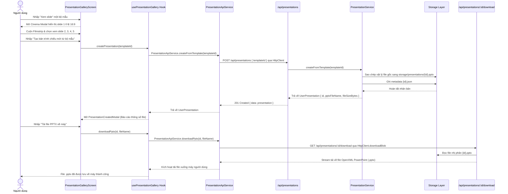

# CẤU TRÚC MÃ NGUỒN & KIẾN TRÚC PHẦN MỀM (STRUCTURE DOCUMENT)
## SẢN PHẨM 2: THƯ VIỆN MẪU TRÌNH CHIẾU (PRESENTATION TEMPLATE LIBRARY)

Tài liệu này giải thích chi tiết cấu trúc thư mục, trách nhiệm của từng thành phần mã nguồn và luồng luân chuyển dữ liệu bên trong **Sản phẩm 2** theo mô hình **Feature-Driven Architecture** và **Pure Data Access Layer**.

---

## 1. SƠ ĐỒ CÂY THƯ MỤC CHI TIẾT (PROJECT TREE)

```
project-2-slide-template/
├── docs/                                  # TÀI LIỆU KỸ THUẬT & QUẢN TRỊ
│   ├── SRS.md                             # Đặc tả yêu cầu phần mềm chi tiết
│   ├── ARCHITECTURE.md                    # Kiến trúc phân lớp, Slide Deck Model & Báo cáo Editor
│   ├── API_SPEC.md                        # Đặc tả toàn bộ API Routes & Contracts
│   ├── PLAN.md                            # Kế hoạch triển khai & danh mục việc cần làm
│   ├── ROADMAP.md                         # Lộ trình phát triển sản phẩm theo các giai đoạn
│   └── STRUCTURE.md                       # Tài liệu cấu trúc mã nguồn này
│
├── public/                                # TÀI NGUYÊN ĐỒ HỌA VECTOR 16:9 (STATIC ASSETS)
│   ├── slides/                            # Toàn bộ 15 trang slide preview tỉ lệ 16:9
│   │   ├── pitch-deck/                    # 5 slide mẫu Pitch Deck gọi vốn
│   │   │   ├── slide-1.svg                # Slide Bìa & Khẩu hiệu
│   │   │   ├── slide-2.svg                # Slide Vấn đề & Giải pháp
│   │   │   ├── slide-3.svg                # Slide Quy mô thị trường TAM-SAM-SOM
│   │   │   ├── slide-4.svg                # Slide Mô hình doanh thu
│   │   │   └── slide-5.svg                # Slide Đội ngũ & Kêu gọi vốn
│   │   ├── quarterly-review/              # 5 slide mẫu Báo cáo hoạt động quý
│   │   │   ├── slide-1.svg                # Slide Bìa báo cáo
│   │   │   ├── slide-2.svg                # Slide Điểm sáng hoạt động
│   │   │   ├── slide-3.svg                # Slide Biểu đồ tài chính
│   │   │   ├── slide-4.svg                # Slide Khối kỹ thuật R&D
│   │   │   └── slide-5.svg                # Slide Mục tiêu quý tới
│   │   └── product-launch/                # 5 slide mẫu Kế hoạch ra mắt sản phẩm
│   │       ├── slide-1.svg                # Slide Bìa Go-To-Market
│   │       ├── slide-2.svg                # Slide Chân dung khách hàng
│   │       ├── slide-3.svg                # Slide Kênh truyền thông
│   │       ├── slide-4.svg                # Slide Lộ trình 3 giai đoạn
│   │       └── slide-5.svg                # Slide Chỉ số KPI mục tiêu
│   └── thumbnails/                        # Ảnh bìa đại diện của từng bộ slide
│       ├── pitch-deck-thumb.svg
│       ├── quarterly-review-thumb.svg
│       └── product-launch-thumb.svg
│
├── src/                                   # MÃ NGUỒN CHÍNH (TYPESCRIPT)
│   ├── app/                               # [App Router] Vỏ định tuyến mỏng (Thin Routing Shell)
│   │   ├── api/                           # TẦNG CONTROLLER / API ROUTES
│   │   │   ├── presentations/
│   │   │   │   ├── route.ts               # POST: Nhân bản PPTX; GET: Danh sách
│   │   │   │   └── [id]/
│   │   │   │       ├── route.ts           # GET: Lấy thông tin bản trình chiếu
│   │   │   │       └── download/
│   │   │   │           └── route.ts       # GET: Stream tải file .pptx nhị phân
│   │   │   └── templates/
│   │   │       ├── route.ts               # GET: Danh sách bộ template & lọc
│   │   │       └── [id]/
│   │   │           └── route.ts           # GET: Chi tiết bộ slide & slide deck
│   │   ├── layout.tsx                     # Layout dùng chung toàn ứng dụng
│   │   ├── not-found.tsx                  # Trang 404 thân thiện
│   │   └── page.tsx                       # Thin shell router -> render PresentationGalleryScreen
│   │
│   ├── features/                          # [Feature-Driven Modules] Phân hệ nghiệp vụ độc lập
│   │   └── presentations/                 # Phân hệ thư viện & duyệt bộ slide
│   │       ├── components/                # Component con dùng riêng (kebab-case)
│   │       │   ├── category-filter.tsx    # Thanh lọc danh mục với badge số lượng
│   │       │   ├── presentation-card.tsx  # Thẻ card hiển thị bộ slide (16:9 Cover)
│   │       │   ├── presentation-created-modal.tsx # Modal xác nhận khởi tạo & Tải file PPTX
│   │       │   └── slide-deck-modal.tsx   # Màn chiếu Cinema 16:9 + Filmstrip Carousel
│   │       ├── hooks/
│   │       │   └── use-presentation-gallery.ts # Hook quản lý search debounce, modal, API calls
│   │       └── screens/
│   │           └── presentation-gallery-screen.tsx # Màn hình thư viện slide hoàn chỉnh
│   │
│   ├── services/                          # [Pure Data Access Layer] Tầng giao tiếp API thuần
│   │   ├── core/
│   │   │   ├── base-api.service.ts        # BaseApiService: Axios Interceptor, Bearer Token, Offline Guard, Path Params
│   │   │   ├── types.ts                   # RequestConfig, BaseResponse<T>, ApiError, HttpMethod
│   │   │   └── http-client.ts             # Re-export BaseApiService & types
│   │   ├── presentations/
│   │   │   └── presentation-api.service.ts # PresentationApiService extends BaseApiService (_get, _post, downloadBlob)
│   │   └── templates/
│   │       └── template-api.service.ts    # TemplateApiService extends BaseApiService (_get with pathParams)
│   │
│   ├── shared/                            # [Shared Foundation & Design System]
│   │   ├── components/
│   │   │   ├── portal-renderer.tsx        # Renderer ở Root Render đè lên toàn ứng dụng
│   │   │   ├── providers/
│   │   │   │   └── ui-provider.tsx        # UIProvider bọc PortalRenderer & Toaster
│   │   │   └── ui/                        # Bộ Shadcn/UI chuẩn hóa (kebab-case)
│   │   │       ├── backdrop.tsx           # Backdrop mờ với hiệu ứng fade mượt mà
│   │   │       ├── badge.tsx              # Huy hiệu phân loại & trạng thái
│   │   │       ├── button.tsx             # Button chuẩn design system (variant & size)
│   │   │       ├── card.tsx               # Khung Card bao bọc nội dung
│   │   │       ├── confirm-modal.tsx      # Modal xác nhận/cảnh báo đa dụng (Portal-ready)
│   │   │       ├── dialog.tsx             # Dialog mở rộng chuẩn Radix UI
│   │   │       ├── input.tsx              # Input field hỗ trợ search icon
│   │   │       ├── modal.tsx              # Modal popup đa kích thước
│   │   │       ├── separator.tsx          # Đường ngăn cách phân vùng
│   │   │       ├── skeleton.tsx           # Khung xương loading shimmer
│   │   │       ├── tabs.tsx               # Bộ tab chuyển đổi
│   │   │       └── tooltip.tsx            # Tooltip giải thích thao tác
│   │   ├── hooks/
│   │   │   └── use-portal.ts              # Hook usePortal, useCloseAllPortals, useClosePortalById
│   │   ├── types/
│   │   │   └── portal.types.ts            # Định nghĩa PortalProps<T>, PortalInstance<T>
│   │   └── utils/
│   │       ├── confirm-modal-helper.ts    # Imperative call confirmModal.show / alert / error
│   │       └── utils.ts                   # Hàm tiện ích cn(), formatFileSize, format ngày tháng
│   │
│   ├── store/                             # [Zustand Stores] Quản lý state toàn cục phân tử
│   │   └── layout.store.ts                # Quản lý mảng Stacking Portals, onPresent, onDismiss
│   │
│   ├── server/                            # TẦNG DỊCH VỤ BACKEND (DOMAIN SERVICES)
│   │   └── services/
│   │       ├── pptx-generator.service.ts  # Khởi tạo và bảo vệ 3 file PPTX gốc
│   │       ├── presentation.service.ts    # Nhân bản độc lập file PPTX (Copy-on-Create)
│   │       ├── storage.service.ts         # Quản lý đọc/ghi storage vật lý
│   │       └── template.service.ts        # Truy vấn, tìm kiếm, lọc bộ mẫu
│   │
│   ├── data/                              # DỮ LIỆU BAN ĐẦU (SEED DATA)
│   │   └── templates.ts                   # 3 bộ template PowerPoint hoàn chỉnh
│   │
│   └── types/                             # ĐỊNH NGHĨA KIỂU DỮ LIỆU & ENUMS
│       └── index.ts                       # SlideCategory, SlideLayoutType, AspectRatio, SlideTemplate
│
├── storage/                               # VÙNG LƯU TRỮ VẬT LÝ (FILE REPOSITORY)
│   ├── presentations/                     # Bản sao PPTX và metadata JSON của người dùng
│   └── templates/                         # File PPTX gốc chuẩn OpenXML (Read-only)
│
├── tests/                                 # BỘ KIỂM THỬ TỰ ĐỘNG (AUTOMATED TEST SUITE)
│   └── verify-all.ts                      # Kiểm thử Slide Deck, Clone PPTX, Magic bytes
│
├── components.json                        # Cấu hình chuẩn Shadcn/UI (New York style, slate base)
├── next.config.ts                         # Cấu hình Next.js
├── package.json                           # Khai báo dependencies & scripts
├── tsconfig.json                          # Cấu hình TypeScript compiler
└── README.md                              # Báo cáo tổng kết bàn giao Sản phẩm 2
```

---

## 2. TRÁCH NHIỆM TỪNG PHÂN TẦNG (LAYERED ARCHITECTURE RESPONSIBILITIES)

| Phân tầng | Vị trí thư mục | Trách nhiệm chính |
| :--- | :--- | :--- |
| **Shared Core Package** | `packages/core` (`@preview/core`, `@preview/core/server`) | • Gói thư viện dùng chung trong Monorepo pnpm workspace.<br>• `HttpClient`: Centralized HTTP Client xử lý query params, interceptor, Blob download.<br>• `BaseCatalogService`: Quản lý catalog, filter search đa tiêu chí, tính counts.<br>• `BaseStorageRepository`: Lớp cơ sở trừu tượng quản lý I/O tệp tin độc lập.<br>• `APP_ROUTES`, `API_ROUTES`: Hằng số URL routes tập trung chống hardcode.<br>• Tiện ích tái sử dụng: `buildUrlWithParams`, `createAttachmentHeaders`, `sanitizeFileName`, `formatFileSize`. |
| **Thin Routing Shell** | `src/app/` | • Chứa routing shells mỏng nhẹ theo Next.js App Router.<br>• Chuyển tiếp trách nhiệm trực tiếp cho `src/features/presentations/screens/`. |
| **Feature-Driven Modules** | `src/features/` | • Đóng gói độc lập theo nghiệp vụ (`presentations/`).<br>• `screens/`: Ghép nối giao diện hoàn chỉnh (`presentation-gallery-screen.tsx`).<br>• `components/`: Component con dùng riêng cho phân hệ (kebab-case).<br>• `hooks/`: Custom hook `use-presentation-gallery.ts` đóng gói state, modal, debounced search và kết nối service layer. |
| **Pure Data Access Layer (BaseApiService)** | `src/services/core/base-api.service.ts`, `src/services/*/` | • Lớp trừu tượng `BaseApiService` bọc `AxiosInstance` chuẩn hóa.<br>• Tự động gắn Bearer Token từ Zustand `useAuthStore`.<br>• Offline Guard ngăn request rác qua `useAppStore`.<br>• Format URL động `:id` và `{id}` qua `pathParams`.<br>• Tự động bóc tách mảng lỗi backend (`flattenApiErrors`) & kích hoạt Toast (`toast.error`).<br>• Các domain services kế thừa `BaseApiService` và gọi `this._get`, `this._post`, `this._put`, `this._delete`. |
| **Custom Portal System** | `src/store/layout.store.ts`, `src/shared/components/portal-renderer.tsx`, `src/shared/hooks/use-portal.ts` | • Quản lý Stacking Portals toàn cục bằng Zustand.<br>• Cho phép gọi modal qua Hook (`usePortal`) và Imperative Call từ tầng Services (`confirmModal.show`).<br>• Giải quyết triệt để vấn đề Z-Index & Stacking Context. |
| **Shared Design System** | `src/shared/components/ui/` | • Bộ thành phần UI Shadcn/UI chuẩn hóa (kebab-case).<br>• Tuân thủ nghiêm ngặt quy chuẩn Button Design System (chỉ dùng variant & size, không custom class ghi đè). |
| **API Controller Layer** | `src/app/api/` | • Xử lý request `POST /api/presentations` (tạo bản sao PPTX).<br>• Xử lý request `GET /api/presentations/:id/download` (stream file `.pptx` nhị phân kèm Content-Type chuẩn). |
| **Domain Service Layer** | `src/server/services/` | • `PptxGeneratorService`: Đảm bảo các file master PPTX chuẩn OpenXML luôn sẵn sàng trên đĩa.<br>• `PresentationService`: Thực thi sao chép tệp vật lý độc lập (`fs.copyFileSync`), ghi metadata `{presentationId}.json`.<br>• `SlideTemplateService`: Tìm kiếm và lọc bộ slide theo danh mục. |
| **Storage Repository Layer** | `src/server/services/storage.service.ts`, `storage/` | • `storage/templates/`: Vùng lưu trữ mẫu gốc, chỉ được cấp quyền Read-Only.<br>• `storage/presentations/`: Vùng lưu trữ bản sao của người dùng. |

---

## 3. SƠ ĐỒ LUỒNG DỮ LIỆU (SEQUENCE DIAGRAM)



---

## 4. CHIẾN LƯỢC QUẢN LÝ DỮ LIỆU & ENUMS CHUẨN HÓA

### Định nghĩa Enums (`src/types/index.ts`):
- `SlideCategory`: `ALL = 'all'`, `PITCH_DECK = 'pitch-deck'`, `QUARTERLY_REVIEW = 'quarterly-review'`, `PRODUCT_LAUNCH = 'product-launch'`, `WORKSHOP = 'workshop'`.
- `SlideLayoutType`: `TITLE = 'title'`, `CONTENT_TWO_COLUMN = 'content-two-column'`, `CHART = 'chart'`, `TIMELINE = 'timeline'`, `METRICS = 'metrics'`.
- `AspectRatio`: `SIXTEEN_NINE = '16:9'`, `FOUR_THREE = '4:3'`.
- `BadgeVariant`: `DEFAULT = 'default'`, `SECONDARY = 'secondary'`, `DESTRUCTIVE = 'destructive'`, `OUTLINE = 'outline'`.
- `ButtonVariant`: `DEFAULT = 'default'`, `SECONDARY = 'secondary'`, `OUTLINE = 'outline'`, `GHOST = 'ghost'`, `SUBTLE = 'subtle'`, `DESTRUCTIVE = 'destructive'`.
- `ButtonSize`: `DEFAULT = 'default'`, `SM = 'sm'`, `LG = 'lg'`, `ICON = 'icon'`.
- `ModalMaxWidth`: `SM = 'sm'`, `MD = 'md'`, `LG = 'lg'`, `XL = 'xl'`, `TWO_XL = '2xl'`, `FOUR_XL = '4xl'`, `FULL = 'full'`.
- `SlideNavigationKey`: `ARROW_LEFT = 'ArrowLeft'`, `ARROW_RIGHT = 'ArrowRight'`, `ESCAPE = 'Escape'`.

### Chiến lược Tính Bất Biến (Immutability Strategy):
1. **Kiểm tra Checksum & Kích thước**: File gốc trong `storage/templates/` có kích thước và thời gian sửa đổi (mtime) cố định. Khi người dùng nhân bản, hệ thống sử dụng hàm copy vật lý của hệ điều hành mà không mở stream ghi vào file gốc.
2. **Kiểm thử tự động (`pnpm test`)**: Kịch bản kiểm thử trong `tests/verify-all.ts` thực hiện ghi nhận `stats.size` và `stats.mtimeMs` của file gốc trước khi nhân bản, sau đó xác nhận lại các giá trị này không hề suy suyển sau khi tạo bài thuyết trình mới.
