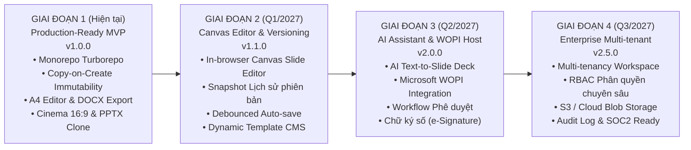

# LỘ TRÌNH PHÁT TRIỂN NỀN TẢNG TỔNG THỂ (MASTER PLATFORM ROADMAP)
## ENTERPRISE DOCUMENT & PRESENTATION TEMPLATE PLATFORM

Tài liệu này vạch ra tầm nhìn chiến lược, các mốc phát hành (Release Milestones) và kế hoạch nâng cấp dài hạn cho toàn bộ nền tảng quản trị mẫu văn bản và trình chiếu văn phòng đa phương tiện.

---

## 1. TỔNG QUAN LỘ TRÌNH 4 GIAI ĐOẠN (STRATEGIC PHASES)

---

## 2. CHI TIẾT CÁC CỘT MỐC PHÁT HÀNH (RELEASE MILESTONES)

### Giai đoạn 1: Phiên bản Hiện tại (v1.0.0 - Production-Ready MVP)
*Trạng thái*: **ĐÃ HOÀN THÀNH 100% (DELIVERED & VERIFIED)**

#### Phân hệ 1: Thư viện Mẫu Văn bản (`apps/project-1-doc-template`)
- [x] Lưới thẻ thư viện Responsive với 5 biểu mẫu văn phòng chuẩn hóa (Hợp đồng, Đơn từ, Biên bản, Báo cáo, Đề xuất).
- [x] Bộ lọc 6 danh mục nghiệp vụ và công cụ tìm kiếm toàn văn thời gian thực (Debounced search).
- [x] Cửa sổ xem trước mô phỏng kích thước và tỷ lệ khổ giấy in ấn A4.
- [x] **Cơ chế Copy-on-Create**: Sao chép sâu nội dung sang UUID độc lập, bảo vệ tuyệt đối mẫu gốc (Template Immutability).
- [x] **Trình soạn thảo Google Docs A4 trực quan (TipTap Engine & tiptap-a4-pagination)**:
  - Tự động phân chia trang in A4 trong thời gian thực khi văn bản tràn trang.
  - Ngắt dòng bảng biểu thông minh giữa các trang, tự động lặp lại hàng tiêu đề (`repeat header row`).
  - Thanh công cụ Google Docs Toolbar: Font family, Cỡ chữ, Căn lề, Màu chữ, Highlight, Bảng biểu, Undo/Redo.
  - 3 chế độ xem khổ giấy (Standard 794px A4, Wide 1100px, Full 1500px).
- [x] Bộ chuyển đổi và xuất tệp tin Microsoft Word (`.docx`) chuẩn thể thức hành chính (Nghị định 30/2020/NĐ-CP), tự động giải mã 100% HTML entities tiếng Việt.

#### Phân hệ 2: Thư viện Mẫu Trình chiếu (`apps/project-2-slide-template`)
- [x] Lưới thẻ bài trình chiếu tỷ lệ 16:9 với 3 bộ slide chất lượng cao (15 slide vector chi tiết).
- [x] Phân loại theo 4 nhóm chuyên ngành (Gọi vốn, Báo cáo quý, Ra mắt sản phẩm).
- [x] **Slide Deck Cinema Preview**: Màn chiếu slide lớn chuẩn 16:9 Cinema HD kèm thanh trượt **Filmstrip Carousel** xem lướt và chuyển đổi slide tức thì.
- [x] **Tích hợp HTML5 Canvas 2D Engine (Fabric.js v7)**:
  - Chuyển đổi linh hoạt giữa chế độ trình chiếu và chế độ vẽ Canvas trực tiếp.
  - Tự động ngắt dòng chữ và co giãn qua `Fabric.Textbox`, loại bỏ lỗi tràn dòng của DOM.
  - Hỗ trợ thêm Textbox, Shape bo góc, chọn đối tượng với bounding box, xoay/scale và xuất ảnh 2x DPI PNG.
- [x] **Cơ chế Physical File Clone**: Sao chép tệp nhị phân vật lý độc lập sang thư mục người dùng, bảo vệ nguyên vẹn 100% file master PPTX.
- [x] Stream download trực tiếp tệp tin Microsoft PowerPoint (`.pptx`) nhị phân chuẩn ECMA-376 được sinh bởi `pptxgenjs`.

#### Nền tảng hạ tầng dùng chung (`packages/core`, `packages/ui`)
- [x] Cấu trúc Turborepo Monorepo kết hợp `pnpm workspace` chuẩn hóa.
- [x] Package `core`: Centralized HttpClient, Lớp cơ sở trừu tượng `BaseStorageRepository`, `BaseCatalogService`, Route Constants và Utilities.
- [x] Package `ui`: Toàn bộ UIKit Design System (Button, Badge, Card, Dialog, Modal, Tabs, Portal System, Toast).
- [x] **Zero-Configuration File Storage**: Lưu trữ JSON & OpenXML nhị phân vật lý, không cần cài đặt Database ngoài.
- [x] Tương thích môi trường Serverless (Vercel) với cơ chế tự động chuyển vùng đệm `/tmp/storage`.
- [x] Bộ kiểm thử tự động (Automated Test Suite) đạt tỷ lệ kiểm chứng 100%.

---

### Giai đoạn 2: Trình Biên Tập Slide Trực Tuyến & Quản Trị Phiên Bản (v1.1.0)
*Kế hoạch dự kiến*: **Quý 1 / 2027**  
*Mục tiêu*: Bổ sung khả năng chỉnh sửa slide trực tiếp trên trình duyệt và quản lý lịch sử văn bản.

1. **In-browser Canvas Slide Editor (Fabric.js / Konva.js)**:
   - Render từng đối tượng slide (Text box, Vector shapes, Images, Charts) lên HTML5 Canvas.
   - Cho phép người dùng kéo thả, thay đổi kích thước, đổi font chữ, màu sắc trực tiếp trên web.
   - Khi lưu, chuyển đổi ngược (Round-trip) các đối tượng Canvas thành tệp tin `.pptx` chuẩn thông qua `pptxgenjs`.
2. **Quản lý Lịch sử Phiên bản (Document Version History & Snapshots)**:
   - Tự động lưu các điểm mốc Snapshot khi có thay đổi lớn (v1.0, v1.1, v1.2...).
   - Giao diện so sánh trực quan (Visual Diffing) làm nổi bật các đoạn văn bản được thêm mới hoặc xóa bỏ.
   - Tính năng One-click Restore để quay lại phiên bản bất kỳ trong quá khứ.
3. **Tự động lưu ngầm thông minh (Debounced Auto-save)**:
   - Lưu ngầm nội dung văn bản sau 1.5 giây người dùng ngừng gõ phím.
   - Hiển thị timestamp trực quan: *"Đã lưu bản nháp lúc 15:42:10"*.
4. **Hệ thống Quản lý Mẫu Động (Dynamic Template CMS)**:
   - Giao diện Admin cho phép tải lên file mẫu `.docx` hoặc `.pptx` từ máy tính.
   - Parser tự động bóc tách nội dung, trích xuất hình ảnh để đưa vào danh mục mẫu của hệ thống mà không cần can thiệp code.

---

### Giai đoạn 3: Trợ Lý Trí Tuệ Nhân Tạo & Microsoft WOPI Enterprise (v2.0.0)
*Kế hoạch dự kiến*: **Quý 2 / 2027**  
*Mục tiêu*: Ứng dụng AI tăng tốc soạn thảo và nhúng trình biên tập cấp doanh nghiệp chuẩn Microsoft.

1. **AI Presentation Generator (Text-to-Slide Deck)**:
   - Nhập một đoạn tóm tắt ý tưởng hoặc tài liệu Word $\rightarrow$ AI tự động phân bổ nội dung thành bộ slide 5–10 trang.
   - Tự động đề xuất bố cục (Problem-Solution, Traction, Timeline) và biểu tượng minh họa phù hợp.
2. **AI Document Copilot**:
   - Tự động hoàn thiện điều khoản hợp đồng dựa trên các thông số pháp lý đầu vào.
   - Kiểm tra lỗi chính tả, văn phong hành chính và chuẩn hóa định dạng văn bản tự động.
3. **Tích hợp Microsoft Office for the Web qua WOPI Protocol**:
   - Triển khai **WOPI Host Server** chuẩn doanh nghiệp của Microsoft.
   - Nhúng trực tiếp iframe PowerPoint Online & Word Online của Microsoft vào hệ thống.
   - Đảm bảo 100% tính tương thích về font chữ, macro, hiệu ứng chuyển động và định dạng nâng cao.
4. **Quy trình Phê duyệt & Chữ ký số (Approval Workflow & e-Signature)**:
   - Thiết lập luồng xét duyệt tài liệu nhiều cấp (Nhân viên $\rightarrow$ Trưởng phòng $\rightarrow$ Giám đốc).
   - Tích hợp ký số điện tử chuẩn OTP/SMS hoặc khóa ký bảo mật PKI.

---

### Giai đoạn 4: Kiến Trúc Đám Mây Đa Người Thuê (v2.5.0 - Enterprise Edition)
*Kế hoạch dự kiến*: **Quý 3 / 2027**  
*Mục tiêu*: Mở rộng nền tảng phục vụ hàng nghìn tổ chức doanh nghiệp đồng thời.

1. **Multi-tenancy Architecture**:
   - Phân tách dữ liệu biệt lập theo từng Workspace / Organization.
   - Tùy biến thương hiệu doanh nghiệp (White-labeling: Logo, Domain riêng, Màu sắc chủ đạo).
2. **Phân quyền người dùng nâng cao (Enterprise RBAC)**:
   - Quản trị viên (Super Admin), Quản lý mẫu (Template Manager), Người soạn thảo (Editor), Người xem (Viewer).
   - Tích hợp đăng nhập một lần doanh nghiệp (SSO via SAML 2.0, Okta, Azure AD, Google Workspace).
3. **Cloud Storage Engine**:
   - Chuyển đổi linh hoạt từ File-based Storage sang Cloud Object Storage (Amazon S3 / Google Cloud Storage / Cloudflare R2).
   - Cơ sở dữ liệu phân tán PostgreSQL kết hợp Prisma ORM và Redis Cache.
4. **Bảo mật & Kiểm toán Doanh nghiệp (Security & Audit Trail)**:
   - Ghi nhận chi tiết toàn bộ nhật ký truy cập, chỉnh sửa và tải tệp (Audit Logs).
   - Sẵn sàng đạt các chứng chỉ tiêu chuẩn an toàn thông tin quốc tế (SOC2 Type II, ISO 27001, GDPR).

---

## 3. MA TRẬN QUẢN TRỊ RỦI RO KỸ THUẬT (RISK MANAGEMENT)

| Rủi ro kỹ thuật | Mức độ | Biện pháp giảm thiểu đã / sẽ triển khai |
| :--- | :---: | :--- |
| **Vỡ layout khi mở file Word/PPTX trên các phần mềm khác nhau** | Cao | • Tuân thủ nghiêm ngặt tiêu chuẩn mở quốc tế ECMA-376 OpenXML. • Sử dụng bộ font hệ thống tiêu chuẩn (Arial, Times New Roman, Calibri) và kích thước cố định. • Triển khai kiểm thử tự động kiểm tra magic bytes nhị phân. |
| **Ghi đè hoặc làm hỏng dữ liệu mẫu gốc** | Rất cao | • Áp dụng triệt để nguyên tắc **Copy-on-Create Immutability**. • Phân tách vật lý thư mục mẫu `storage/templates/` (Read-only) và tài nguyên người dùng. • Khóa quyền ghi đĩa đối với kho mẫu ban đầu. |
| **Tràn bộ nhớ khi xử lý file OpenXML dung lượng lớn** | Trung bình | • Áp dụng cơ chế Node.js Stream khi tải file nhị phân. • Xử lý tải bất đồng bộ (Chunked transfer) trên API routes. |
| **Xung đột phiên bản khi nhiều người cùng chỉnh sửa** | Trung bình | • Giai đoạn 1: Cô lập bản sao riêng biệt cho từng người dùng. • Giai đoạn 2: Tích hợp cơ chế khóa tài liệu (Document Locking) và giải thuật CRDT / Operational Transformation. |

---

## 4. ĐỊNH HƯỚNG KIẾN TRÚC BACKEND & KẾ HOẠCH BÓC TÁCH (BACKEND DECOUPLING ROADMAP)

### 4.1. Lý do lựa chọn Next.js Route Handlers ở giai đoạn hiện tại (MVP):
- **Tập trung & Tự cấp tự túc (All-in-one Monorepo)**: Tận dụng trực tiếp Next.js Route Handlers (BFF pattern) để đóng gói trọn vẹn cả Frontend và Backend APIs trong cùng một workspace Turborepo.
- **Tối ưu hóa quá trình Kiểm thử & Trải nghiệm đánh giá (Zero-Configuration Testing)**: Giúp đội ngũ phát triển, bộ phận thẩm định và hệ thống CI/CD có thể chạy thử, kiểm thử tự động (Unit / Integration tests) và deploy ngay lập tức mà không cần khởi động cụm microservices hoặc thiết lập Database bên ngoài.
- **Tiêu chuẩn hóa Data Access Layer**: Tầng Client gọi API được bọc hoàn toàn qua `BaseApiService` (kế thừa `HttpClient` từ package `core`), phân tách triệt để logic giao diện khỏi logic giao tiếp dữ liệu.

### 4.2. Kế hoạch di chuyển khi hệ thống mở rộng (Microservices Migration Plan):
- **Tách Backend thành Standalone Service (NestJS / Go / Fastify)**:
  - Khi lưu lượng truy cập và khối lượng xử lý tệp tin OpenXML tăng cao, toàn bộ tầng Domain Services (`src/server/services/`: DocumentService, PptxGeneratorService, DocxExportService, StorageService) sẽ được bóc tách độc lập thành một Dedicated Backend Microservice.
  - Chuyển đổi tầng lưu trữ tệp vật lý sang **Cloud Object Storage (Amazon S3 / Cloudflare R2)** và cơ sở dữ liệu phân tán **PostgreSQL + Prisma ORM + Redis Cache**.
- **Không làm gián đoạn Frontend (Zero Frontend Refactoring)**:
  - Nhờ có cấu hình `BASE_API` và kiến trúc `BaseApiService` tập trung trong package `core`, khi chuyển sang Backend độc lập mới, tầng Frontend chỉ cần cấu hình lại duy nhất biến môi trường `NEXT_PUBLIC_BASE_API=https://api.production.com` mà **hoàn toàn không phải chỉnh sửa bất kỳ dòng mã nguồn nào ở tầng giao diện người dùng**.

